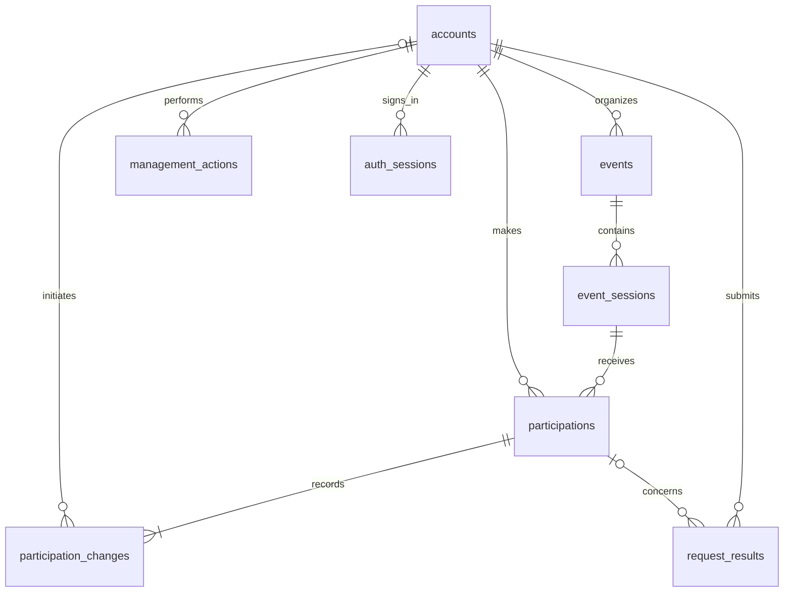
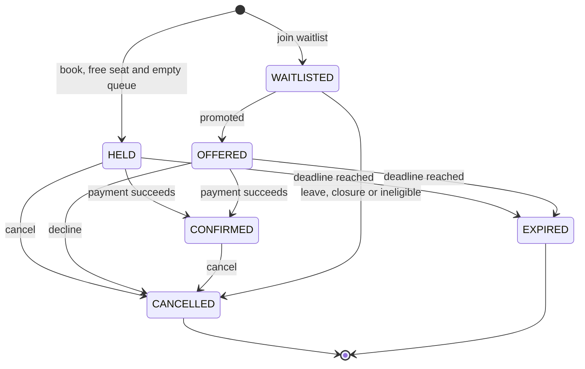

# Database design specification

Cloud-Native Event Booking Platform with Automatic Waitlisting  
Design version 1.2 · 14 November 2026 · Proposed schema for PRD 1.2  
Requirements source: [Product requirements document](PRD.md) · Implementation design: [Technical design document](TECHNICAL_DESIGN.md)

Terms follow the PRD's terminology table. "Session" always means an event session. A SQLAlchemy session is written `AsyncSession`. Attendees cancel a hold or confirmed booking, decline an offer and leave the waitlist; all three end in `CANCELLED`.

Changes in 1.2: section 2.5 adds the `auth_sessions` table for refresh tokens, previously described only in Section 6.2 of the technical design.

Changes in 1.1: sessions carry a `version` column; a transaction that frees a seat promotes the queue head itself; all writers share one locking entry point and lock timeouts; registration writes continue during a Redis outage; the command rules are numbered steps with a SQL sketch.

## 1. Storage model

A seat belongs to a session. Each attempt to attend that session has one participation record, from the initial hold or waitlist entry through its final outcome. Accepting a waitlist offer confirms the same attempt. An attendee who withdraws and later rejoins gets a new attempt and a new place in line.

PostgreSQL owns the accounts, inventory, queue order, deadlines and history. FastAPI and the workers use the same transaction rules through SQLAlchemy 2.0's asynchronous interface. Alembic owns schema revisions. Redis handles rate limiting and notifications. Workers can recover all outstanding booking work by querying PostgreSQL.



## 2. Data dictionary

All columns are required unless marked nullable. Each `id` is a UUID primary key generated by the writer. Foreign keys use `ON DELETE RESTRICT`. Store instants as `timestamptz` and configure database connections for UTC. The session's IANA time zone identifies the local time to display. State, role and reason codes use `text` with named check constraints. Free-text reasons are separate from those codes.

### 2.1 Accounts and events

| Table | Column | PostgreSQL type | Definition |
| --- | --- | --- | --- |
| `accounts` | `id` | uuid | Account identifier. |
| | `email` | text | Login and contact address. Trim on input. Enforce uniqueness on `lower(email)`. |
| | `display_name` | text | Nonblank name for attendee and organizer views. |
| | `password_hash` | text | Encoded, salted password hash. |
| | `role` | text | `ATTENDEE` (default), `ORGANIZER` or `ADMIN`. Organizers retain attendee privileges. |
| | `disabled_at` | timestamptz, nullable | A value disables business writes and private subscriptions. |
| | `created_at` | timestamptz | Database time at account creation. |
| `events` | `id` | uuid | Event identifier. |
| | `organizer_id` | uuid | FK to `accounts.id`. Identifies the owner for management access. |
| | `title`, `description`, `location` | text | Each field must contain nonblank text. |
| | `status` | text | `DRAFT` (default), `PUBLISHED` or `CANCELLED`. |
| | `cancelled_at`, `cancellation_reason` | timestamptz, text, both nullable | Both required for a cancelled event and null otherwise. |
| | `created_at` | timestamptz | Database time at creation. |

Public registration always assigns the attendee role. The deployment bootstrap creates the first administrator. Granting or revoking organizer privileges requires an administrator and a management action in the same transaction. Revoking a role preserves the event's ownership history. Access checks use the account's current role and enabled status.

### 2.2 Event sessions

| Column | PostgreSQL type | Definition |
| --- | --- | --- |
| `id`, `event_id` | uuid | Primary key and FK to `events.id`, respectively. |
| `name`, `time_zone` | text | Nonblank session name and validated IANA zone, for example `America/Toronto`. |
| `status` | text | `DRAFT` (default), `PUBLISHED` or `CANCELLED`. Public registration requires both event and session to be published. |
| `registration_opens_at`, `registration_closes_at` | timestamptz | Inclusive opening and exclusive closing instants. |
| `starts_at`, `ends_at` | timestamptz | Scheduled start and end. |
| `capacity` | integer | Maximum occupied seats. Check `capacity > 0`. |
| `last_queue_seq` | bigint | Last assigned queue number. Default zero, check nonnegative. Increment under the session lock. |
| `version` | bigint | Change counter for stale-update detection. Default zero. Increment under the session lock in every transaction that changes the session's participations, capacity or status. |
| `cancelled_at`, `cancellation_reason` | timestamptz, text, both nullable | Both required for a cancelled session and null otherwise. |

Enforce `registration_opens_at < registration_closes_at AND registration_closes_at <= starts_at AND starts_at < ends_at` with a row check. Publication locks the event and publishes at least one valid session in the same transaction. Drafts are visible to the owner with management privileges and to administrators. After publication, organizers may edit the description and location and adjust capacity. A schedule edit locks the session and checks for **any** participation, including terminal attempts. The first attempt freezes the registration times, session times and display zone. Rescheduling then requires a replacement session.

### 2.3 Participations

| Column | PostgreSQL type | Definition |
| --- | --- | --- |
| `id` | uuid | Attempt identifier. Confirmation, cancellation, decline and withdrawal target this ID. |
| `session_id`, `account_id` | uuid | FKs to `event_sessions.id` and `accounts.id`. Immutable for the life of the attempt. |
| `state` | text | One of the six states in section 3. |
| `queue_seq` | bigint, nullable | Positive FIFO number assigned on joining. Null for a direct booking. Preserve after leaving the queue. |
| `created_at` | timestamptz | Allocation time for a direct hold or enqueue time for a waitlist entry. |
| `allocated_at`, `deadline_at` | timestamptz, both nullable | First seat allocation and its effective deadline. Set together and preserve through confirmation, cancellation or expiration. |
| `confirmed_at` | timestamptz, nullable | Time of successful simulated payment. Preserve after cancellation. |
| `ended_at`, `end_reason` | timestamptz, text, both nullable | Required exactly in `CANCELLED` and `EXPIRED`. |

Row checks require a queue number for `WAITLISTED` and `OFFERED` and a null queue number for `HELD`. A waiting row has no allocation. Held, offered, confirmed and expired rows require an allocation and a deadline later than allocation. A confirmed row requires `allocated_at <= confirmed_at < deadline_at`. Only confirmed rows and subsequently cancelled bookings may carry a confirmation time. A cancelled attempt can retain the fields of any previous active state.

The following indexes enforce uniqueness across attempts. The queue number remains reserved even after the attempt ends.

```sql
CREATE UNIQUE INDEX uq_participations_active_account
    ON participations (session_id, account_id)
    WHERE state IN ('HELD', 'WAITLISTED', 'OFFERED', 'CONFIRMED');

CREATE UNIQUE INDEX uq_participations_queue_seq
    ON participations (session_id, queue_seq)
    WHERE queue_seq IS NOT NULL;
```

### 2.4 History and request results

#### Participation history (`participation_changes`)

| Column | PostgreSQL type | Definition |
| --- | --- | --- |
| `participation_id`, `change_no` | uuid, integer | Composite primary key. The ID references the attempt. Number its transitions consecutively from 1. |
| `from_state`, `to_state` | text, text | Previous and new participation states. Only the first transition has a null source state. |
| `occurred_at`, `reason_code` | timestamptz, text | Database transition time and cause. Use `BOOKED`, `ENQUEUED`, `PROMOTED`, `PAYMENT_CONFIRMED` or a terminal reason from section 3. |
| `actor_id`, `correlation_id` | uuid nullable, uuid | FK to the initiating account, null for a worker. The correlation ID groups changes from one operation. |

Append the transition under the session lock, in the transaction that writes the new state. A failed simulated payment has a request result but no state transition.

#### Command receipts (`request_results`)

| Column | PostgreSQL type | Definition |
| --- | --- | --- |
| `account_id`, `request_id` | uuid | Composite primary key. The account FK scopes the client-supplied request ID to one caller. |
| `operation`, `parameter_hash` | text, bytea | Command name and digest of its business inputs. |
| `participation_id` | uuid, nullable | FK to the attempt when the outcome concerns an identified attempt. |
| `http_status`, `result_code` | smallint, text | Original response status and stable business outcome, including a business rejection. |
| `result_body`, `recorded_at` | jsonb, timestamptz | Fields needed to replay the original response and the time it was recorded. |

#### Management audit (`management_actions`)

| Column | PostgreSQL type | Definition |
| --- | --- | --- |
| `id`, `actor_id` | uuid | Primary key and FK to the account performing the action. |
| `action`, `reason` | text | Operation name and nonblank explanation. |
| `occurred_at`, `correlation_id` | timestamptz, uuid | Database time and identifier shared by all effects of the operation. |
| `target_account_id`, `target_event_id`, `target_session_id`, `target_participation_id` | uuid, each nullable | FKs to accounts, events, event sessions and participations, respectively. A check on `num_nonnulls` across the four columns requires exactly one target. |

The application roles can insert and read history rows. They cannot update or delete them. Management actions record account disablement, permission changes, administrative booking cancellations and organizer or administrator event cancellations. A whole-event cancellation has one management action. Its correlation ID links every affected participation transition to the actor and the stated reason. Preserve events, sessions and attempts with booking history.

### 2.5 Authentication sessions (`auth_sessions`)

One row is one issued refresh token. A login starts a family of rows; each refresh retires the presented row and inserts its successor in the same family. The technical design, Sections 6.2 and 9, defines the token, cookie and CSRF behavior that uses this table.

| Column | PostgreSQL type | Definition |
| --- | --- | --- |
| `id`, `account_id` | uuid | Primary key and FK to `accounts.id`. |
| `family_id` | uuid | Shared by every token descended from one login. The first row of a family uses a new value. |
| `refresh_token_hash` | bytea | SHA-256 digest of the random 256-bit token. Unique. The plaintext token is never stored. |
| `csrf_token_hash` | bytea | SHA-256 digest of the CSRF value. Copied unchanged to every successor in the family. |
| `created_at`, `last_used_at` | timestamptz | Database time at issue and at the latest successful use. |
| `expires_at` | timestamptz | Absolute expiry of the login. Copied unchanged to every successor, so rotation never extends it. Check `expires_at > created_at`. |
| `rotated_at` | timestamptz, nullable | Set when a refresh replaces this token with its successor. |
| `revoked_at`, `revoke_reason` | timestamptz, text, both nullable | Both set or both null. The reason is `LOGOUT`, `REUSE_DETECTED` or `ACCOUNT_DISABLED`. |
| `user_agent_hash`, `last_ip_prefix` | bytea, text, both nullable | Digest of the client's user-agent string and a truncated network prefix, kept for investigation without storing raw client data. |

A token is usable when `rotated_at` and `revoked_at` are both null and `expires_at` is later than the database time. The unique index on `refresh_token_hash` serves the lookup on every refresh. Index `(account_id, expires_at)` for revoking an account's logins, and `family_id` for revoking one family.

Authentication transactions take no event or session locks. Each one first takes a shared lock on the account and checks that it is enabled. Refresh and logout then lock the presented token row `FOR UPDATE`:

- **Login** inserts the first row of a new family.
- **Refresh** stamps `rotated_at` and `last_used_at` on the presented row and inserts the successor, in one transaction. A second refresh of the same token within five seconds of `rotated_at` changes nothing and returns `REFRESH_ALREADY_ROTATED`. A later reuse stamps `revoked_at` with `REUSE_DETECTED` on every row of the family that is not already revoked.
- **Logout** stamps `revoked_at` with `LOGOUT` on every row of the family that is not already revoked.
- **Disable account** already holds the exclusive account lock from section 4. In the same transaction it stamps `revoked_at` with `ACCOUNT_DISABLED` on every unrevoked row of the account. The shared lock taken by a concurrent refresh makes that refresh either finish first, so its successor is revoked, or wait and then find the account disabled.

Rows are never updated except to stamp these columns. Expired rows may be deleted by a housekeeping job; nothing depends on them after `expires_at`.

## 3. State transitions and seat accounting

| Source | Operation and condition | Destination | Change in occupied seats |
| --- | --- | --- | ---: |
| New | Direct booking while open, free seat, empty queue | `HELD` | +1 |
| New | Explicit join while open, full session or existing queue | `WAITLISTED` | 0 |
| `WAITLISTED` | Earliest eligible entry receives a free seat while open | `OFFERED` | +1 |
| `HELD`, `OFFERED` | Simulated payment succeeds before the effective deadline | `CONFIRMED` | 0 |
| `HELD`, `OFFERED` | Database time reaches the effective deadline | `EXPIRED` | -1 |
| `HELD`, `OFFERED`, `CONFIRMED` | Permitted attendee or management cancellation | `CANCELLED` | -1 |
| `WAITLISTED` | Withdrawal, ineligibility, registration closure or event/session cancellation | `CANCELLED` | 0 |



Event or session cancellation moves every active attempt to `CANCELLED`.

Compute occupancy from the count of `HELD`, `OFFERED` and `CONFIRMED` rows. Every allocation and capacity edit must satisfy `occupied <= capacity`. A past-due row counts until the release transaction changes its state. The baseline schema has no separately maintained seat counter.

Sample the database clock when writing the allocation. Set `deadline_at` to the earlier of registration closure and allocation time plus the configured validity period, five minutes for a direct hold and ten minutes for an offer. Configuration changes affect future allocations. Failed simulated payment leaves the state and deadline intact. The schema stores no payment credentials.

Use the terminal reason codes `USER_CANCELLED`, `WITHDRAWN`, `OFFER_DECLINED`, `HOLD_EXPIRED`, `OFFER_EXPIRED`, `REGISTRATION_CLOSED`, `ACCOUNT_DISABLED`, `INELIGIBLE`, `SESSION_CANCELLED`, `EVENT_CANCELLED` and `ADMIN_CANCELLED`. Closure expires outstanding holds and offers and ends waiting entries. A hold or offer whose deadline was shortened by closure ends with `HOLD_EXPIRED` or `OFFER_EXPIRED`, like any other missed deadline. `REGISTRATION_CLOSED` applies only to waiting entries. Confirmed bookings survive closure and display as ended once the session finishes. Terminal attempts have no outgoing transitions.

## 4. Write transactions

### Lock order and clock

Use PostgreSQL `READ COMMITTED`. For a booking command, lock the parent event `FOR SHARE`, then its session `FOR UPDATE`. Read occupancy, active attempts and the queue in subsequent statements after obtaining the session lock. This permits concurrent transactions on different sessions of one event. Every writer that changes participation, capacity or queue order, including a worker, must acquire the same locks. A row check alone cannot enforce a sum across participation rows. [PostgreSQL row locks](https://www.postgresql.org/docs/current/explicit-locking.html#LOCKING-ROWS)

Take an exclusive event lock for whole-event edits or cancellation. For a multi-session operation, lock sessions by ascending ID. After event and session locks, lock the accounts whose permissions or eligibility the command uses, in ascending account ID order. Use a shared account lock for a permission or eligibility check and an exclusive lock for a role or disablement change. Account-only changes need no session locks. Select the applicable lock mode on first acquisition. A worker processes one queue head per transaction, so it can identify the account before locking it.

The capacity rule has no database constraint behind it. It holds only if every writer follows this lock order. Implement the order once, in a single function that returns the locked event, session and account rows, and have the API and the workers call that function for every write. Code that locks these rows any other way fails review.

Set `lock_timeout` to 5 seconds, `statement_timeout` to 10 seconds and `idle_in_transaction_session_timeout` to 15 seconds on API and worker connections. Requests queued behind a busy session each hold a pooled connection, so an unbounded wait can exhaust the pool. A lock timeout rolls back, returns a retryable 503 and leaves the request ID available.

After all potentially blocking locks, read `clock_timestamp()` immediately before testing time and writing the transition. Registration is open when both statuses are published and `registration_opens_at <= t AND t < registration_closes_at`. Confirmation also requires `t < deadline_at`. PostgreSQL's `now()` returns the transaction start time, which can precede a lock wait. A request that waited past its deadline must fail even if it arrived on time. [PostgreSQL current date and time](https://www.postgresql.org/docs/current/functions-datetime.html#FUNCTIONS-DATETIME-CURRENT)

### Command rules

Every command below runs after the locks and clock read described above. Every transaction that changes a participation, the capacity or a status increments the session's `version`.

**Book or join**

1. Check for an existing active attempt. If one exists, return its status without allocating again or changing priority.
2. Book: if a seat is free and the queue is empty, insert a `HELD` row with its allocation time and deadline. Otherwise return `WAITLIST_REQUIRED`.
3. Join: if a seat is free and the queue is empty, return `DIRECT_BOOKING_AVAILABLE`. Otherwise increment `last_queue_seq` and insert a `WAITLISTED` row carrying the returned number in the same transaction.

**Confirm, cancel, decline or leave**

1. Select the named attempt with its owner and session, and check its current state.
2. If a hold or offer is overdue, record its expiration first. The attendee's action then meets an expired attempt.
3. If registration has closed, end a waiting entry with `REGISTRATION_CLOSED` even if the worker is late.
4. Confirm: a successful simulation sets `CONFIRMED` and `confirmed_at`. A failed simulation leaves the state and deadline intact and can be retried with a new request ID before the original deadline.
5. Cancel, decline and leave are allowed only before the session starts. A repeated request changes zero seats.
6. If the command freed a seat, run the promote steps in the same transaction.

**Change capacity**

1. Count occupied rows under the session lock.
2. Reject a new capacity below that count.
3. After an increase, run the promote steps in the same transaction, so the existing queue receives the new seats ahead of new arrivals.

**Promote**

Promotion runs inside any transaction that frees a seat or raises capacity, since that transaction already holds the session lock. The worker scan in section 5 runs the same steps for seats freed by expiry and as a safety net.

1. Recheck that registration is open and a seat is free.
2. Read the lowest `queue_seq` still in `WAITLISTED`.
3. Take a shared lock on that account and check its eligibility.
4. End an ineligible entry with its reason, or issue one offer and stamp its deadline.
5. Repeat while seats and waiters remain, up to 20 offers per transaction. The worker scan picks up any remainder.

Never use `SKIP LOCKED` to select attendees within a session. Promotion locks queue-head accounts after the caller's account, outside ascending ID order. This cannot deadlock, because promotion takes only shared account locks and each role or disablement change takes exactly one exclusive account lock.

**Disable account**

1. Stamp `disabled_at` and insert the audit action atomically.
2. Pending allocations expire on their original deadlines.
3. Workers skip disabled waiters and record why.
4. A confirmed booking keeps its seat until a separate, explicit administrative cancellation.

**Cancel event or session**

1. Check ownership or administrator privileges.
2. Session cancellation marks that session `CANCELLED`. Event cancellation marks the event and every session not already cancelled, locking the sessions in ascending ID order.
3. End all active attempts with `SESSION_CANCELLED` or `EVENT_CANCELLED`, append their transitions and record one management action, all in one commit.
4. Later commands and workers recheck the parent status. Historical reads show "Event cancelled" from the parent while each attempt keeps its original history.

**Booking transaction sketch**

The statements below show a direct booking. Application code decides between the branches; the final four statements run only when the booking succeeds.

```sql
BEGIN;  -- READ COMMITTED
SELECT status FROM events WHERE id = :event_id FOR SHARE;
SELECT capacity, status, registration_opens_at, registration_closes_at
  FROM event_sessions WHERE id = :session_id FOR UPDATE;
SELECT disabled_at FROM accounts WHERE id = :account_id FOR SHARE;

SELECT http_status, result_code, result_body, parameter_hash
  FROM request_results
 WHERE account_id = :account_id AND request_id = :request_id;

SELECT clock_timestamp() AS t;

SELECT count(*) FILTER (WHERE state IN ('HELD', 'OFFERED', 'CONFIRMED')) AS occupied,
       count(*) FILTER (WHERE state = 'WAITLISTED') AS waiting,
       count(*) FILTER (WHERE account_id = :account_id
                          AND state IN ('HELD', 'WAITLISTED', 'OFFERED', 'CONFIRMED')) AS mine
  FROM participations
 WHERE session_id = :session_id;

-- Proceed only if open at t, mine = 0, waiting = 0 and occupied < capacity.
INSERT INTO participations
       (id, session_id, account_id, state, created_at, allocated_at, deadline_at)
VALUES (:id, :session_id, :account_id, 'HELD', :t, :t,
        least(:t + interval '5 minutes', :registration_closes_at));
INSERT INTO participation_changes
       (participation_id, change_no, from_state, to_state, occurred_at,
        reason_code, actor_id, correlation_id)
VALUES (:id, 1, NULL, 'HELD', :t, 'BOOKED', :account_id, :correlation_id);
UPDATE event_sessions SET version = version + 1 WHERE id = :session_id;
INSERT INTO request_results
       (account_id, request_id, operation, parameter_hash, participation_id,
        http_status, result_code, result_body, recorded_at)
VALUES (:account_id, :request_id, 'BOOK', :parameter_hash, :id,
        201, 'HELD', :result_body, :t);
COMMIT;
```

### Idempotency and uncertain commits

Before executing a command, check for an existing receipt by account and request ID. Check again after acquiring the session lock, so that a retry racing its original finds the committed receipt. For each authenticated command, calculate a SHA-256 digest over the canonical operation, target IDs and business parameters, including the simulated payment outcome. A retry uses the same account and request ID. Recheck current access before returning a stored result. A matching digest replays the original result. A different digest returns a conflict.

Insert the completed `request_results` row in the transaction containing the business effects. If concurrent transactions for the same key reach the unique constraint, roll back the **entire** losing transaction, then read and compare the winning result in a fresh transaction. Send success only after commit. Rate-limit and dependency failures before execution leave the key available for retry.

Keep request results for the release, satisfying the PRD's 24-hour minimum and preserving the identity of old creation requests. Mutations of existing attempts always name the original participation ID. After a timeout, an authenticated caller can look up its request or read the current attempt. An old cancellation cannot affect a later re-registration.

## 5. Reads, indexes and recovery

| Access path | Index or query |
| --- | --- |
| Published event list | Index `event_sessions(event_id, starts_at)` and `events(organizer_id)`. For each published event, sort by its nearest upcoming published session start, then event ID. Place events without an upcoming session last. Use 20 events per page. Search title and description with a bound keyword. The open filter requires at least one published session inside its registration window. |
| Session availability and organizer roster | Index `participations(session_id, state)`. Aggregate the four active states in one statement. For an open session, available seats equal capacity minus occupied seats. Closed or cancelled sessions accept no bookings regardless of that difference. Keep the roster and counts on one snapshot when returning them together. |
| FIFO and position | Partial index on `(session_id, queue_seq) WHERE state = 'WAITLISTED'`. Position is one plus the count of waiting rows in the same session with a lower sequence. Offered and terminal attempts have no position. |
| My registrations | Index `participations(account_id, created_at DESC)`. Prioritize held and offered attempts by deadline. Filter by authenticated account before returning private data. |
| Expiry and closure scans | Index `participations(deadline_at, session_id) WHERE state IN ('HELD','OFFERED')` and `event_sessions(registration_closes_at) WHERE status = 'PUBLISHED'`. For closure work, select sessions with outstanding unconfirmed attempts. |

Worker scans discover due holds and offers, closed sessions with unfinished entries, and open sessions with both waiting entries and free capacity. Candidate reads grant no rights to allocate. Each worker reacquires the write locks, reloads the row and checks the clock. A stale candidate becomes a no-op. Scan every second by default, in bounded batches, revisit skipped sessions and measure the oldest due item. A worker restart preserves the original deadlines and queue numbers.

Publish session count changes and private refresh notifications only after commit. Public messages contain no attendee identifiers. Private subscriptions require an enabled account, a valid token and ownership. Queue changes invalidate displayed positions. Every session read and every push carries the session's `version`. Clients fetch authoritative state on reconnect or after a notification and discard any response or push with a lower version than the one displayed. They poll every ten seconds while disconnected and reconcile every 60 seconds while connected, because Redis Pub/Sub can drop a message on a healthy connection. Redis loss leaves database reads, registration writes and workers available. Each API replica limits writes with an in-process fallback until Redis recovers. PostgreSQL loss returns an unavailable outcome for business writes.

## 6. SQLAlchemy 2.0 and Alembic

Use one `DeclarativeBase` for the models and a shared `MetaData` naming convention for primary keys, foreign keys, unique constraints, checks and indexes. Map columns with `Mapped[T]` and `mapped_column()`. Map timestamps with `DateTime(timezone=True)`. Declare PostgreSQL partial indexes with `Index(..., postgresql_where=...)` so Alembic sees the same predicates as the model.

Create one `AsyncEngine` per process with `create_async_engine()` and a `postgresql+asyncpg` URL supplied through the environment. Use `async_sessionmaker(engine, expire_on_commit=False)` and open one `AsyncSession` per request or worker transaction. A concurrent task needs its own `AsyncSession`. Scope writes with `async with session_factory.begin() as db`. Use `select(...).with_for_update(read=True)` for shared locks and `.with_for_update()` for exclusive row locks. Load locked state in a fresh `AsyncSession` or explicitly refresh cached ORM instances. Build response data within the transaction and return it after the context exits successfully. [SQLAlchemy 2.0 asyncio](https://docs.sqlalchemy.org/en/20/orm/extensions/asyncio.html)

Initialize the migration environment once with `uv run alembic init -t async migrations`. In `env.py`, import all mapped models, set `target_metadata = Base.metadata` and read the database URL from the deployment environment. The online runner opens an async connection and calls `await connection.run_sync(do_run_migrations)`. Revision functions use Alembic's synchronous `op` interface. Pin SQLAlchemy 2.0.x, asyncpg and Alembic through the project's uv lockfile. [Alembic asyncio cookbook](https://alembic.sqlalchemy.org/en/latest/cookbook.html#using-asyncio-with-alembic)

| Stage | Procedure |
| --- | --- |
| Author | Run `uv run alembic revision --autogenerate -m "create booking schema"`. Review constraint names, partial predicates, foreign keys, defaults and both revision directions. Write renames, data backfills and changes omitted by autogeneration explicitly. |
| Verify | Apply `uv run alembic upgrade head` to a clean PostgreSQL database and to a populated copy of the preceding revision. Run `uv run alembic current`, compare with `uv run alembic heads`, run `uv run alembic check`, and exercise the booking invariants. Test reversible downgrades on a disposable copy. |
| Deploy | Run one migration job before starting replicas that require the new revision. The migration role owns DDL. API and worker roles receive only the data privileges they need. A failed migration blocks the rollout. |
| Change a live schema | Add compatible columns or indexes first, backfill existing rows, validate constraints and switch readers and writers. Remove obsolete fields after old replicas have drained. For a destructive change, document data recovery and the forward repair before deployment. |

## 7. Operations and acceptance

PostgreSQL runs on private networking with a persistent volume and credentials supplied by local configuration or Kubernetes Secrets. The release uses a single database instance. Remounting the volume preserves committed state across Pod replacement. Recovery from storage loss requires a separate backup.

Size the connection budget at maximum replica count. For each database client, multiply replicas by processes per replica and by `pool_size + max_overflow`. Add migration and monitoring connections and reserve headroom for administration. Monitor actual connections during scale-out, along with overdue rows, oldest overdue age, promotion latency and capacity violations. Alert immediately on a capacity violation. Alert when the oldest overdue item stays more than 30 seconds late for one minute.

The capacity-violation metric and every concurrency test use the same check. It must return no rows:

```sql
SELECT s.id, s.capacity, count(p.id) AS occupied
FROM event_sessions s
JOIN participations p
  ON p.session_id = s.id AND p.state IN ('HELD', 'OFFERED', 'CONFIRMED')
GROUP BY s.id
HAVING count(p.id) > s.capacity;
```

A worker runs it on each scan cycle and exports the row count as the metric. Tests run it after every round.

The following are acceptance tests for the proposed schema. Run concurrency cases against PostgreSQL with independent connections.

| PRD | Test | Required observation |
| --- | --- | --- |
| FR-01 to FR-03 | Browse as a guest, request another attendee's record, edit another organizer's event, publish without a session and edit times after a withdrawn attempt. | Access and publication rules hold. The withdrawn attempt still freezes the schedule. |
| FR-04, FR-05, FR-10 | Capacity 20, 100 concurrent clients, 1,000 mixed requests per round for ten rounds. Race a capacity reduction against allocation. | Zero capacity violations and duplicate active attempts. Count rate-limited requests separately. |
| FR-05, FR-07 | Hold a lock across the deadline, then allow a waiting confirmation and two expiry workers to proceed. | Confirmation at or after the deadline fails. Exactly one transition releases the seat. |
| FR-06 to FR-08 | Withdraw and rejoin, disable the queue head, release multiple seats and run competing workers. Race event cancellation against promotion. | New joins take the tail. Offers follow eligible sequence order. Cancelled sessions have no active offers. |
| FR-09, FR-10 | Drop a response after commit, retry with matching and changed parameters, then replay an old cancellation after a new booking. Disconnect and reconnect the gateway. | Original result or parameter conflict. The new attempt survives. Private state and deadlines recover through reads. |
| FR-07, NFR-01, NFR-02 | Restart workers and the database with overdue allocations. Drop Redis. Run at maximum application replicas. | Committed state survives. Registration writes continue under the fallback limiter while Redis is down. Backlog clears within 30 seconds of recovery. Healthy P95 from expiry deadline or cancellation commit to persisted offer is at most five seconds, measured separately over at least 100 observations per cause. Record pool usage and alert delivery. |
