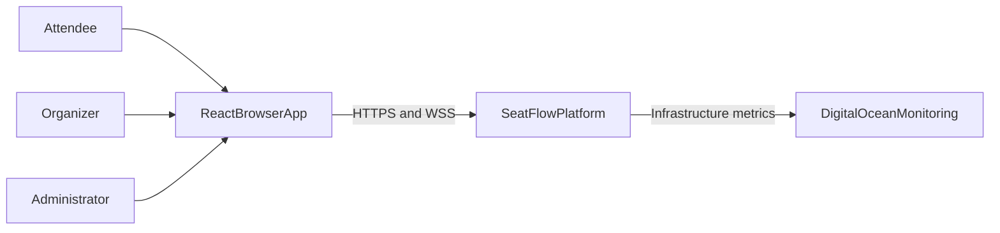
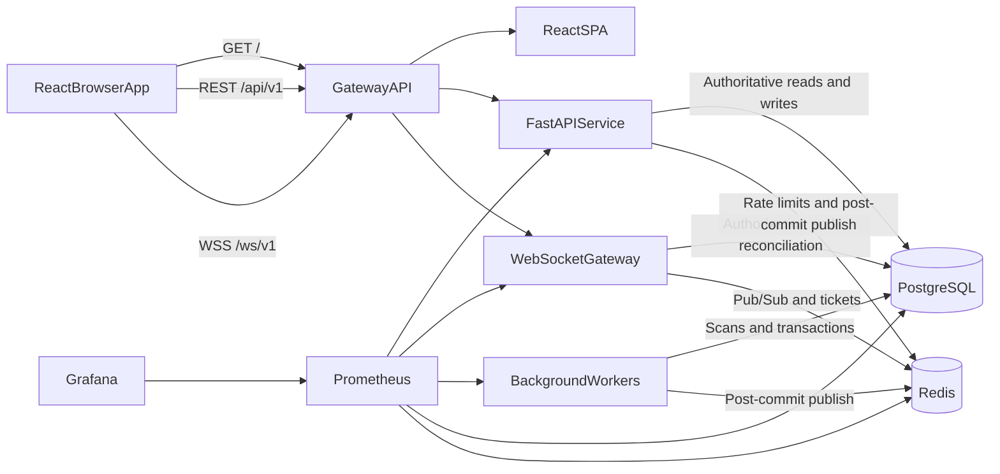
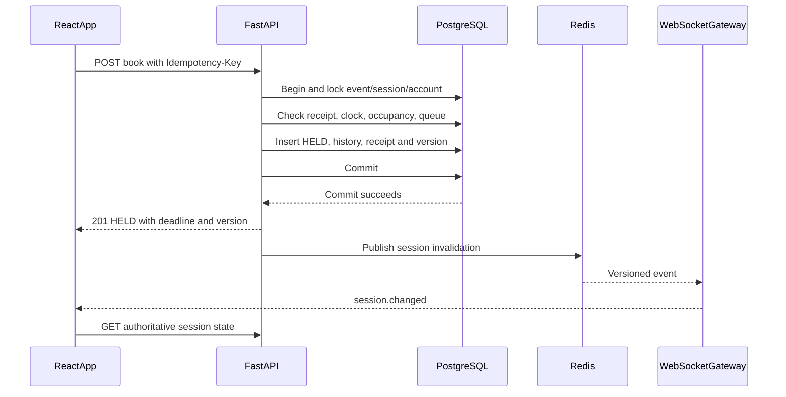

# Technical Design Document: Cloud-Native Event Booking Platform

Version: 1.0  
Date: 2026-11-14  
Status: Proposed target design; implementation pending

## 1. Purpose

This document describes the planned technical implementation of the cloud-native event booking platform. It covers the system architecture, service responsibilities, data and concurrency model, API and real-time communication, security, deployment, observability, and delivery sequence.

The design is based on [Project_Proposal.md](Project_Proposal.md), [PRD.md](PRD.md), and [DATABASE_DESIGN.md](DATABASE_DESIGN.md). PostgreSQL remains the source of truth for booking state, while Redis supports rate limiting and real-time delivery without becoming part of the core correctness boundary.

Requirement identifiers such as FR-04 and NFR-01 refer to the PRD.

## 2. Implementation status

The following work remains to be implemented:

- Database models, Alembic migrations, repositories, or transactions.
- Account registration, authentication, authorization, and administration.
- Event, session, booking, confirmation, cancellation, or waitlist APIs.
- Expiration and promotion workers.
- Redis rate limiting or post-commit notifications.
- WebSocket gateway and frontend.
- Kubernetes manifests, migration jobs, monitoring, dashboards, alerts, or load tests.

The remaining sections describe planned behavior rather than completed or measured results.

## 3. Goals, constraints, and decisions

### 3.1 Design goals

- Never allocate more occupied seats than a session's capacity.
- Preserve one active participation per account and session.
- Promote eligible attendees in persistent FIFO order.
- Make retries, duplicate tasks, process restarts, and lost responses safe.
- Keep booking writes correct and available when Redis is unavailable.
- Recover authoritative UI state after lost or out-of-order notifications.
- Scale stateless API and WebSocket processes without moving correctness out of PostgreSQL.
- Produce evidence for the PRD's concurrency, latency, recovery, and scaling acceptance targets.

### 3.2 Non-goals

The first release does not implement real payments, refunds, seat selection, ticket types, group bookings, transfers, check-in, scheduling conflict detection, priority queues, email or SMS delivery, multi-region recovery, automatic PostgreSQL failover, or inventory pre-deduction in Redis.

### 3.3 Resolved technical decisions

- Backend: Python 3.14, FastAPI, Pydantic, SQLAlchemy 2.0 async, asyncpg, and Alembic.
- Frontend: React, TypeScript, and Vite as a dynamic browser SPA built into static deployable assets.
- Authentication: short-lived signed JWT access tokens and rotating opaque refresh tokens in an `HttpOnly` cookie.
- Reliable work: PostgreSQL scans and idempotent database transactions.
- Real-time delivery: Redis Pub/Sub as best-effort invalidation; REST remains authoritative.
- Concurrency: PostgreSQL `READ COMMITTED` plus a common event/session/account row-locking entry point.
- Public routing: DOKS-managed Gateway API using the `cilium` GatewayClass.
- Local orchestration: Docker Compose; Kubernetes validation: minikube; cloud: DOKS.

## 4. System architecture

### 4.1 System context



### 4.2 Runtime containers



### 4.3 Component responsibilities

**React SPA frontend**

- Provides event list, event details, My Registrations, and management pages.
- Loads as static HTML, JavaScript, and CSS, then behaves dynamically in the browser through REST state changes and WebSocket updates.
- Sends commands through REST and treats REST responses as authoritative.
- Uses WebSocket messages as invalidation signals, not as the sole copy of business state.
- Discards state older than the highest displayed session version.

**FastAPI service**

- Owns HTTP authentication, RBAC and ownership checks.
- Exposes public queries, attendee commands, and management operations.
- Applies rate limits before business transactions.
- Runs all business writes through the shared locking and command layer.
- Publishes sanitized invalidation messages only after a successful commit.

**Background workers**

- Scan PostgreSQL for overdue holds and offers, closed registrations, and sessions needing promotion.
- Reacquire the same locks as API writers and recheck every candidate.
- Process bounded batches safely across multiple replicas.
- Export backlog, latency, and capacity-invariant metrics.

**WebSocket gateway**

- Upgrades browser connections using short-lived, single-use connection tickets.
- Maintains public session subscriptions and authenticated private subscriptions.
- Consumes Redis Pub/Sub messages and sends small versioned invalidation events.
- Reauthorizes private delivery and closes expired or disabled sessions.
- Does not decide booking outcomes or retain authoritative booking state.

**PostgreSQL**

- Owns accounts, refresh sessions, events, sessions, participation attempts, queue order, deadlines, idempotency receipts, and audit history.
- Serializes writes affecting one event session.
- Supplies database time for deadline decisions.

**Redis**

- Stores rate-limit counters and one-time WebSocket tickets.
- Fans out post-commit invalidations.
- May be lost without losing booking facts. Redis persistence improves restart behavior but is not a correctness boundary.

## 5. Proposed repository structure

The API, workers, and WebSocket gateway share one Python package and image. Different container commands start different process types.

```text
.
├── app/
│   ├── main.py                  # FastAPI factory and lifecycle
│   ├── api/
│   │   ├── dependencies.py      # Authentication, DB, request context
│   │   └── v1/                  # Auth, events, sessions, participations, admin
│   ├── core/
│   │   ├── config.py
│   │   ├── errors.py
│   │   ├── logging.py
│   │   ├── metrics.py
│   │   └── security.py
│   ├── db/
│   │   ├── base.py
│   │   ├── engine.py
│   │   └── locks.py             # The only business-write lock entry point
│   ├── models/
│   ├── schemas/
│   ├── services/                # Transactional command and query services
│   ├── realtime/                # Publish and WebSocket gateway
│   └── workers/                 # Scan loops and candidate handlers
├── migrations/
├── frontend/
│   ├── src/
│   │   ├── api/
│   │   ├── auth/
│   │   ├── components/
│   │   ├── pages/
│   │   ├── realtime/
│   │   └── routes/
│   └── package.json
├── deploy/
│   ├── compose/
│   ├── kubernetes/
│   │   ├── base/
│   │   └── overlays/
│   ├── monitoring/
│   └── scripts/
├── tests/
│   ├── unit/
│   ├── integration/
│   ├── concurrency/
│   ├── contract/
│   └── load/
├── compose.yaml
├── Dockerfile
└── pyproject.toml
```

Route handlers validate transport data and call services. Services own authorization-sensitive business decisions and transactions. Models never publish messages. Realtime publication receives committed result objects after the transaction context has exited.

## 6. Domain and persistence design

### 6.1 Core records

The schema in `DATABASE_DESIGN.md` remains the baseline:

- `accounts`
- `events`
- `event_sessions`
- `participations`
- `participation_changes`
- `request_results`
- `management_actions`

The participation states are exactly `HELD`, `WAITLISTED`, `OFFERED`, `CONFIRMED`, `CANCELLED`, and `EXPIRED`. Only `HELD`, `OFFERED`, and `CONFIRMED` occupy seats.

The following invariant is checked in transactions, tests, and monitoring:

```text
count(HELD) + count(OFFERED) + count(CONFIRMED) <= event_sessions.capacity
```

The partial unique index on active `(session_id, account_id)` prevents multiple active attempts for one attendee. The unique `(session_id, queue_seq)` index preserves queue identity across terminal attempts.

Direct holds last five minutes by default. Waitlist offers last ten minutes by default. In both cases the persisted deadline is:

```text
deadline_at = min(allocation_time + configured_validity, registration_closes_at)
```

The validity settings affect new allocations only; they never rewrite an existing deadline.

### 6.2 Authentication persistence addendum

Authentication requires one additional table not yet present in the database design:

`auth_sessions`

- `id uuid` primary key.
- `account_id uuid` references `accounts.id` with `ON DELETE RESTRICT`.
- `refresh_token_hash bytea` is a unique SHA-256 digest of a random 256-bit token; the plaintext token is never stored.
- `family_id uuid` groups tokens descended from one login.
- `csrf_token_hash bytea` binds refresh and logout requests to the browser session.
- `created_at`, `last_used_at`, and `expires_at` are `timestamptz`.
- `rotated_at`, `revoked_at`, and `revoke_reason` are nullable.
- `user_agent_hash bytea` and `last_ip_prefix text` support investigation without storing unnecessary raw client data.

Indexes cover `(account_id, expires_at)` and unexpired token lookup. Refresh rotation locks the presented row, marks it rotated, and inserts its successor in one transaction. Every successor keeps the family's original absolute expiry and CSRF digest; rotation does not extend the login lifetime. A second concurrent refresh received within a five-second grace window returns `409 REFRESH_ALREADY_ROTATED` without revoking the family. Reuse after that window is treated as theft and revokes the family. Disabling an account revokes its refresh sessions in the same management transaction.

This addendum must be incorporated into the first Alembic revision and the next database-design revision.

### 6.3 Time and versions

- Store all instants as `timestamptz` and use UTC database connections.
- Preserve an IANA display time zone on each event session.
- Use `clock_timestamp()` after all blocking locks for registration and deadline decisions.
- Never use browser time, API process time, or PostgreSQL transaction-start `now()` to decide whether a hold can confirm.
- Increment `event_sessions.version` in every committed transaction that changes capacity, status, or any participation in the session.
- Include `session_version` in session reads, participation reads, command results, and real-time events.

## 7. Transaction and concurrency design

### 7.1 Common lock entry point

All API and worker writes that can affect participation, capacity, queue order, or session status call one shared function in `app/db/locks.py`. Direct locking elsewhere is prohibited.

For a normal session command:

1. Read an existing idempotency receipt as a non-locking fast path.
2. Lock the parent event `FOR SHARE`.
3. Lock the event session `FOR UPDATE`.
4. Recheck the receipt, then read occupancy, queue, and active attempts.
5. Lock accounts whose role or eligibility is used with shared locks, in ascending account-ID order.
6. Read `clock_timestamp()` after all potentially blocking locks.
7. Validate and write the transition, history, version, and receipt in one transaction.

Whole-event edits use an exclusive event lock. Multi-session operations lock sessions in ascending UUID order. Account role or disablement changes use an exclusive account lock. Promotion is the documented exception to ascending account-ID order: the session lock fixes the queue, and each queue-head account is taken with a shared lock; role and disablement commands lock only their one target account exclusively, so they cannot form a cycle with promotion. The connection settings are:

- `lock_timeout = 5s`
- `statement_timeout = 10s`
- `idle_in_transaction_session_timeout = 15s`

A lock timeout rolls back and returns a retryable `503 LOCK_TIMEOUT`. It does not consume the idempotency key.

### 7.2 Direct booking and waitlist join

Booking under the session lock:

1. Return an existing active attempt without creating another one.
2. Require published event and session status and an open registration window.
3. Count occupied seats and active waiters.
4. If a seat is free and the queue is empty, insert `HELD`.
5. Otherwise return `WAITLIST_REQUIRED`; never enqueue implicitly.

Joining the waitlist under the same lock:

1. Return an existing active attempt without changing its order.
2. Require an enabled account, published event and session, and an open registration window.
3. If direct booking is possible, return `DIRECT_BOOKING_AVAILABLE`.
4. Require waitlisting to be necessary because the session is full or an active queue exists.
5. Increment `last_queue_seq` and insert `WAITLISTED` atomically.

### 7.3 Confirmation and expiration race

Confirmation locks the session and attempt, then reads database time. If `t >= deadline_at`, it first expires the attempt and promotes from the queue in the same transaction; confirmation returns `PARTICIPATION_EXPIRED`. Otherwise a successful simulation changes `HELD` or `OFFERED` to `CONFIRMED` without changing occupancy. A simulated failure changes no participation state and leaves the original deadline intact.

The worker follows the same lock path. A stale expiry candidate becomes a no-op. The session lock ensures that confirmation and expiration cannot both win.

### 7.4 Cancellation, capacity changes, and promotion

Any transaction that frees a seat or increases capacity promotes waiters before commit:

1. Recheck that registration remains open and a seat is free.
2. Select the lowest active `queue_seq`.
3. Take a shared lock on that account and check its eligibility.
4. End an ineligible entry with a recorded reason, or change it to `OFFERED`.
5. After that account lock, sample `clock_timestamp()` and recheck registration time.
6. Set `allocated_at` to that database time and set `deadline_at` to the earlier of ten minutes later and registration close.
7. Increment the session version for every transaction that changes the queue or occupancy.
8. Repeat for available seats, up to 20 offers per transaction, obtaining a fresh database time after each new blocking account lock.

Do not use `SKIP LOCKED` to choose attendees within one session. It may be used only to distribute independent scan candidates across sessions. Capacity reductions are rejected below current occupancy. Existing waiters are promoted before new arrivals can directly book.

### 7.5 Idempotency

All authenticated business commands require an `Idempotency-Key` header containing a client-generated UUID. The server scopes it by account and stores its result in `request_results`.

- The parameter hash covers the operation, target IDs, and canonical business input.
- A matching retry replays the original status and body after current access is rechecked.
- Reusing a key with different inputs returns `409 IDEMPOTENCY_CONFLICT`.
- The receipt is inserted in the same transaction as business effects.
- If a unique-key race occurs, the losing transaction rolls back completely and reads the winner in a fresh transaction.
- Lock timeouts, rate-limit rejection, and dependency failure before execution do not consume the key.
- Receipts are retained for this release, exceeding the PRD's 24-hour minimum.

For FR-10.3, “reuse” means reuse of an identifier whose command reached execution and has a stored receipt. A request rejected before execution has not claimed the identifier, so it remains available for retry.

The frontend creates a key at the start of an operation and reuses it until the outcome is resolved. On a network timeout it displays “Checking result” and queries the command result or current participation instead of generating a new operation.

### 7.6 Booking sequence



If publication fails after commit, the API response remains successful. Other clients recover through periodic reconciliation or reconnection. The system does not roll back committed business state because Redis notification failed.

## 8. HTTP API contract

### 8.1 Conventions

- Base path: `/api/v1`.
- JSON uses `snake_case` to match Python schemas.
- UUIDs are lowercase canonical strings.
- Timestamps are RFC 3339 UTC values with an explicit `Z`.
- List endpoints use an opaque, URL-safe cursor and `limit` defaulting to 20 and capped at 100. A cursor encodes the endpoint's deterministic sort key and ID tie-breaker; clients must not construct it.
- Mutating authenticated business endpoints require `Idempotency-Key`. Login, token refresh, logout, and real-time ticket issuance are exempt.
- Every response includes `X-Request-ID`; a safe client-supplied value may be retained, otherwise the server creates one.
- A response concerning one session includes `session_version` in `meta`. Multi-session responses carry `version` on every session or participation item, and the client tracks versions by `session_id`.
- OpenAPI is generated by FastAPI and checked into CI as a contract artifact.

Successful single-resource response:

```json
{
  "data": {},
  "meta": {
    "request_id": "uuid",
    "server_time": "2026-11-14T22:00:00Z",
    "session_version": 12
  }
}
```

Error response:

```json
{
  "error": {
    "code": "WAITLIST_REQUIRED",
    "message": "No seat can be booked directly while the session is full or queued.",
    "retryable": false,
    "details": {}
  },
  "meta": {
    "request_id": "uuid",
    "server_time": "2026-11-14T22:00:00Z",
    "session_version": 12
  }
}
```

### 8.2 Authentication and account routes

- `POST /accounts`: create an attendee account.
- `POST /auth/login`: verify credentials, return an access token, and set refresh and CSRF cookies.
- `POST /auth/refresh`: rotate the refresh token and return a new access token.
- `POST /auth/logout`: revoke the current refresh session and clear cookies.
- `POST /realtime/tickets`: create a public-only anonymous ticket, or an authenticated ticket that may include private scopes.
- `GET /me`: return the current account, role, and disabled status.
- `GET /admin/accounts`: list accounts; administrator only.
- `PATCH /admin/accounts/{account_id}`: disable an account or change its role with an audit reason.

Public registration always creates `ATTENDEE`. The bootstrap command creates the first administrator. No public route accepts an administrator or organizer role.

### 8.3 Event and session routes

Public:

- `GET /events`: published events with keyword, open-registration, and cursor filters, sorted by nearest upcoming published session start and then event ID; events without an upcoming session appear last.
- `GET /events/{event_id}`: published event details and sessions; the owner or an administrator may also retrieve a draft.
- `GET /sessions/{session_id}`: session details, availability snapshot, queue count, and version.

Organizer or administrator:

- `POST /events`
- `PATCH /events/{event_id}`
- `POST /events/{event_id}/sessions`
- `PATCH /sessions/{session_id}`
- `POST /events/{event_id}/publish`
- `POST /sessions/{session_id}/cancel`
- `POST /events/{event_id}/cancel`
- `GET /sessions/{session_id}/roster`

Cancellation requests require a nonblank reason. Ownership is checked in the service layer even when the UI hides an action.

Drafts are visible only to their owner and administrators. Publication requires at least one valid session. Once any participation exists, registration times, session times, and display time zone cannot change. After publication, description and location may change, capacity may increase, and capacity may decrease only to current occupancy or above.

Session cancellation locks and marks the session `CANCELLED`, terminalizes its active attempts, appends their histories, increments the session version, and records the management action in one transaction. Event cancellation takes an exclusive event lock, locks sessions in ascending ID order, marks the parent and sessions cancelled, terminalizes every active attempt, appends history, increments affected versions, and records one management action in the same commit. If the bounded statement timeout is exceeded, the whole transaction rolls back and returns a retryable failure; no partial cancellation is exposed. Historical participation responses derive the visible label “Event cancelled” from a cancelled parent while preserving each attempt's original transition history and reason.

`GET /sessions/{session_id}/roster` returns categorized counts and lists for `HELD`, `OFFERED`, `CONFIRMED`, and `WAITLISTED`. It uses one SQL statement/CTE or a read-only `REPEATABLE READ` transaction so counts and rows represent one snapshot. Waitlist rows include a one-based position computed only among active `WAITLISTED` rows.

### 8.4 Participation routes

- `POST /sessions/{session_id}/book`
- `POST /sessions/{session_id}/waitlist`
- `GET /sessions/{session_id}/my-participation`
- `GET /me/participations`
- `GET /participations/{participation_id}`
- `POST /participations/{participation_id}/confirm`
- `POST /participations/{participation_id}/cancel`
- `POST /participations/{participation_id}/decline`
- `POST /participations/{participation_id}/leave`
- `POST /admin/participations/{participation_id}/cancel`: administrator cancellation with a required audit reason.
- `GET /requests/{request_id}`: retrieve the caller's stored command outcome.

The confirmation body contains only `simulation_result: "success" | "failure"`. The platform does not accept card or bank data.

`GET /sessions/{session_id}/my-participation` returns the active attempt when one exists; otherwise it returns the latest terminal attempt and marks it as historical. `GET /me/participations` returns all attempts, prioritizing active `HELD` and `OFFERED` records by deadline.

Command outcomes are fixed as follows:

- A new hold or waitlist entry returns `201`.
- An existing active participation or repeated terminal command returns `200` with the unchanged current result.
- Successful confirmation, cancellation, decline, or leave returns `200`.
- Simulated payment failure returns `200 PAYMENT_SIMULATION_FAILED` and preserves the state and deadline.
- `WAITLIST_REQUIRED` and `DIRECT_BOOKING_AVAILABLE` return `409` with current availability and version; they do not consume capacity or create participation.
- Expired, closed, cancelled, started, or invalid-transition commands return `409`.

Private records owned by another attendee return `404`, not `403`. Management endpoints return `403` when the authenticated manager lacks the required role or ownership.

### 8.5 Stable result and error codes

Success and business result codes:

- `HELD`, `WAITLISTED`, `OFFERED`, `CONFIRMED`, `CANCELLED`, `EXPIRED`
- `PAYMENT_SIMULATION_FAILED`
- `EXISTING_ACTIVE_PARTICIPATION`
- `WAITLIST_REQUIRED`
- `DIRECT_BOOKING_AVAILABLE`

Client and authorization errors:

- `VALIDATION_ERROR` (`422`)
- `AUTHENTICATION_REQUIRED`, `INVALID_CREDENTIALS`, `TOKEN_EXPIRED` (`401`)
- `FORBIDDEN`, `ACCOUNT_DISABLED` (`403`)
- `RESOURCE_NOT_FOUND` (`404`)
- `IDEMPOTENCY_CONFLICT`, `INVALID_STATE_TRANSITION` (`409`)
- `REGISTRATION_NOT_OPEN`, `REGISTRATION_CLOSED`, `SESSION_CANCELLED`, `EVENT_CANCELLED` (`409`)
- `PARTICIPATION_EXPIRED`, `SESSION_STARTED`, `CAPACITY_BELOW_OCCUPIED` (`409`)
- `WAITLIST_REQUIRED`, `DIRECT_BOOKING_AVAILABLE`, `REFRESH_ALREADY_ROTATED` (`409`)
- `RATE_LIMITED` (`429`, with `Retry-After`)

Dependency and concurrency errors:

- `LOCK_TIMEOUT` (`503`, retryable)
- `DATABASE_UNAVAILABLE` (`503`, retryable)
- `SERVICE_UNAVAILABLE` (`503`, retryable)

Expected business rejections are not logged as server errors and are counted separately from unexpected `5xx` responses.

### 8.6 Schema and validation contract

The OpenAPI components use these stable shapes; implementation may add read-only fields without changing their meanings:

- `AccountCreate`: `email`, `display_name`, and `password`. Email is normalized for comparison, display name is 1–100 nonblank characters, and password is 12–128 characters. Role is not accepted.
- `LoginRequest`: `email` and `password`.
- `TokenResponse`: `access_token`, `token_type: "Bearer"`, `expires_in`, and `account`.
- `EventCreate`: `title`, `description`, and `location`, each nonblank with documented maximum lengths.
- `EventPatch`: only `title`, `description`, and `location`; unknown fields are rejected.
- `SessionCreate`: `name`, `time_zone`, `registration_opens_at`, `registration_closes_at`, `starts_at`, `ends_at`, and positive integer `capacity`.
- `SessionPatch`: the same fields, subject to publication and participation-freeze rules; unknown fields are rejected.
- `CancelRequest`: nonblank `reason` from 1–500 characters for management cancellation; attendee self-cancellation has no free-text reason.
- `AdminAccountPatch`: optional `role`, optional `disabled`, and required nonblank `reason`; at least one change is required.
- `ConfirmRequest`: exactly one `simulation_result` enum and no payment fields.
- Booking, waitlist join, decline, leave, and attendee cancellation have empty JSON bodies.

`SessionView` includes status and times, IANA zone, capacity, `occupied_count`, `available_count`, `waitlist_count`, registration status, and `version`. `ParticipationView` includes IDs, state, queue position only while actively waitlisted, allocation and confirmation timestamps, absolute deadline, terminal reason, owning session summary, and session version. `RosterView` contains the categorized snapshot described in Section 8.3. Every write schema rejects unknown fields.

The contract tests freeze required fields, enum values, authorization, idempotency requirement, response status, and result code for every route. A generated-client diff is reviewed like a source change.

## 9. Authentication, authorization, and security

This section implements the proposal's Section 2.4 security direction—authenticated access, permission checks, rate limiting, and HTTPS—and the more specific account and security requirements in PRD FR-01 and NFR-03. The proposal does not prescribe JWT, refresh-token, or CSRF mechanics; Sections 9.1 and 9.2 define those implementation choices.

### 9.1 Passwords and tokens

- Hash passwords with Argon2id using a maintained password library and calibrated parameters.
- Issue a signed JWT access token with a 15-minute lifetime.
- Required claims are `iss`, `aud`, `sub`, `iat`, `nbf`, `exp`, and `jti`.
- Keep the access token in browser memory and send it as `Authorization: Bearer`.
- Generate a random 256-bit refresh token with a 7-day absolute lifetime.
- Store the refresh token only in a `Secure`, `HttpOnly`, `SameSite=Lax` cookie scoped to `/api/v1/auth`.
- Store only its SHA-256 digest in PostgreSQL and rotate it on every refresh.
- Keep signing keys in local secrets or Kubernetes Secrets, never in source control.

The signing algorithm and key size are pinned in configuration and cannot be selected from an incoming token header. Initial implementation uses EdDSA with an Ed25519 private signing key and public verification key.

### 9.2 CSRF and browser storage

Login sets a separate `Secure`, `SameSite=Lax`, non-HttpOnly CSRF cookie. Refresh and logout require the same value in `X-CSRF-Token`; the server compares its digest with the authentication session. The CSRF value remains stable for one refresh-token family and is cleared on logout or family revocation. State-changing business APIs use the bearer access token and do not authenticate from the refresh cookie.

The frontend must not put access or refresh tokens in `localStorage`. A page reload obtains a new access token through the cookie-protected refresh endpoint.

### 9.3 Current-account enforcement

JWT validation proves token integrity but does not replace current authorization checks. Every protected HTTP request loads the account and rejects an expired token, disabled account, or insufficient current role. Organizer ownership is checked against the target event.

Disabling an account:

1. Locks and marks the account disabled.
2. Revokes all refresh sessions.
3. Records a management action in the same commit.
4. Publishes a post-commit control invalidation when Redis is available.

The WebSocket gateway closes affected connections on that invalidation, checks account state before private delivery, and periodically revalidates connected accounts. Redis loss cannot grant protected HTTP access.

### 9.4 WebSocket connection tickets

Browsers cannot reliably add an `Authorization` header to a WebSocket upgrade. A client therefore calls `POST /realtime/tickets`, which is exempt from business-command idempotency.

- An anonymous request may obtain only public published-session scope.
- An authenticated request may obtain public, own-participation, and authorized management scopes.
- The API creates a random, single-use ticket valid for 30 seconds.
- Redis stores only a ticket digest with account ID when present, access-token expiry, and permitted scope.
- The browser offers `seatflow.v1` and `seatflow.ticket.<base64url-ticket>` through `Sec-WebSocket-Protocol`; the gateway selects `seatflow.v1`.
- The gateway validates the `Origin`, atomically consumes the ticket, and redacts the protocol header from logs.
- Ticket issuance or connection fails when Redis is unavailable; the UI falls back to public or authenticated REST polling.

This Redis dependency affects real-time convenience only. It does not block booking, confirmation, cancellation, or authoritative queries.

### 9.5 Additional controls

- Validate all inputs with explicit size and format bounds.
- Parameterize all SQL through SQLAlchemy.
- Restrict CORS to the deployed frontend origin.
- Set HSTS, content security policy, frame, MIME-sniffing, and referrer headers at the gateway or frontend.
- Redact passwords, cookies, authorization and WebSocket protocol headers, tokens, and unnecessary personal data from logs.
- Apply configurable `REGISTRATION_WRITE_LIMIT_PER_MINUTE=30` per account and `LOGIN_LIMIT_PER_MINUTE=10` per source IP by default.
- Trust forwarded client IP headers only from the DOKS gateway's configured proxy ranges. Normalize IPv4 and IPv6 addresses before limiting and ignore spoofed forwarded headers from other peers.
- During Redis loss, each API replica uses an in-process limiter with the same thresholds and reports degraded accuracy.

## 10. Real-time and frontend design

### 10.1 Message contract

WebSocket messages are small invalidation events:

```json
{
  "type": "session.changed",
  "event_id": "uuid",
  "session_id": "uuid",
  "version": 13,
  "reason": "participation_changed",
  "occurred_at": "2026-11-14T22:00:01Z"
}
```

Private event:

```json
{
  "type": "participation.changed",
  "session_id": "uuid",
  "participation_id": "uuid",
  "version": 13,
  "reason": "offer_created",
  "occurred_at": "2026-11-14T22:00:01Z"
}
```

Public messages contain no attendee identifiers. Private messages identify only records owned by the authenticated account and are refresh triggers; the browser fetches the authoritative resource through REST. Supported types are:

- `session.changed`
- `participation.changed`
- `management.changed`
- `auth.revoked`
- `system.resync_required`

Messages may be duplicated, dropped, or received out of order. A client ignores an event whose version is lower than the newest version it has applied. A version gap triggers an immediate REST refresh.

### 10.2 Connection and subscription protocol

After upgrade, the gateway sends `connection.ready` with the connection ID, authenticated account ID when present, and heartbeat interval. Clients send:

```json
{"type":"subscribe","request_id":"uuid","channels":["session:uuid","me:participations"]}
```

The gateway replies with `subscription.ack` listing accepted and rejected channels. `unsubscribe` uses the same shape. Anonymous sockets may subscribe only to published `session:{id}` channels. Authenticated sockets may also use `me:participations`; organizer channels are accepted only after current ownership or administrator checks. A connection is limited to 50 public session channels and one private account scope.

The gateway sends a WebSocket ping every 25 seconds and closes a connection that does not pong within 10 seconds. It closes expired authentication with code `4401`, unauthorized scope with `4403`, policy or subscription-limit violations with `4408`, and transient server failure with `1011`. Clients reconnect with capped exponential backoff and recreate subscriptions from current page state.

Before private delivery, the gateway verifies that the account remains enabled and the access-token expiry has not passed. It revalidates an otherwise idle authenticated connection every 60 seconds. `auth.revoked` contains no session version and instructs immediate logout. `management.changed` carries each affected session ID and version. `system.resync_required` has a reason and no version; it forces immediate REST reconciliation. After reconnecting to Redis Pub/Sub, every gateway emits `system.resync_required` to all connected clients.

### 10.3 Publication

After a transaction commits, the API or worker publishes:

- A public session invalidation when availability, queue count, capacity, or status changes.
- A private participation invalidation for each affected account.
- A management invalidation for authorized organizer views.

Publication is best-effort and bounded by a short timeout. Failure increments a metric and is logged with the correlation ID. There is no database outbox in the baseline; 60-second reconciliation and reconnect reads close the notification gap.

### 10.4 Frontend state

The frontend uses React Router for page routing and TanStack Query for server-state caching. An OpenAPI-generated TypeScript client prevents handwritten request/response drift.

- Event list: browsing, search, open-registration filter, and pagination.
- Event details: sessions, availability, current participation, deadline, and context-sensitive primary action.
- My Registrations: active and historical attempts, with time-limited actions first.
- Management: event/session editing, publication, cancellation, rosters, and permitted administration.

The UI:

- Uses both text and color for status and supports keyboard operation.
- Displays the exact statement “Simulated payment; no actual charge” and collects no payment credentials.
- Explains a waitlist position as “Currently number N; a seat is not guaranteed.”
- Uses a confirmation dialog for attendee and administrative cancellation.
- Shows submission progress and disables duplicate clicks while preserving the operation key.
- Uses server time plus response receipt time to display approximate countdowns.
- Refreshes when a countdown reaches zero; it never releases or confirms a seat locally.
- Shows “Real-time connection temporarily unavailable” while disconnected.
- Polls relevant state every 10 seconds while disconnected.
- Stops fallback polling after reconnect but reconciles every 60 seconds while connected.
- Fetches authoritative state on page entry, reconnect, version gap, and uncertain command outcome.

## 11. Worker design and recovery

One worker process can run all scan types initially. Each scan has an independent loop, bounded batch size, metrics, cancellation handling, and backoff on dependency failure.

Scans run every second by default:

1. Due `HELD` and `OFFERED` rows.
2. Published sessions past registration close with unfinished unconfirmed attempts.
3. Open sessions that have both free capacity and waiters.
4. The capacity-invariant query used for alerting.

Candidate selection does not grant authority to mutate. For each candidate, the worker starts a new transaction, invokes the common lock entry point, reloads state, reads database time, and either applies one valid transition or does nothing. Expiration and closure transactions promote eligible waiters when registration remains open.

At registration close, the worker changes outstanding `HELD` and `OFFERED` rows to `EXPIRED` with their corresponding expiration reason, changes `WAITLISTED` rows to `CANCELLED` with `REGISTRATION_CLOSED`, and leaves `CONFIRMED` rows unchanged. It issues no new offers at or after close. Each transition retains history and increments the session version.

Multiple workers may scan concurrently. Batches may distribute independent sessions with `SKIP LOCKED`, but promotion inside one session always reads the true lowest eligible `queue_seq`.

On shutdown, workers stop taking candidates and finish or roll back active transactions within the Kubernetes termination grace period. On restart, all work is rediscovered from PostgreSQL; no in-process timer or Redis message is required.

## 12. Failure behavior

**Redis unavailable**

- PostgreSQL-backed reads and all registration writes continue.
- API replicas use approximate in-process rate limits.
- WebSocket ticket creation and live notifications are unavailable.
- Connected clients fall back to polling after disconnection; healthy but stale clients reconcile within 60 seconds.
- Workers continue scanning, expiring, and promoting.
- On Redis recovery, gateways force immediate client reconciliation before resuming normal invalidations.

**PostgreSQL unavailable**

- Business reads and writes return `503 DATABASE_UNAVAILABLE`.
- No component allocates from Redis or cached availability.
- WebSocket invalidations may continue briefly but clients cannot treat them as authoritative.
- Components reconnect with bounded exponential backoff and resynchronize after recovery.

**API response lost after commit**

- The receipt and business effect remain atomic.
- A retry with the same idempotency key replays the result.
- The client can query `/requests/{request_id}` or its current participation.

**Publisher crash after commit**

- The state remains valid.
- Other clients recover by reconnecting or periodic REST reconciliation.

**Worker or gateway restart**

- Workers rediscover persisted deadlines and queue state.
- Browsers reconnect and fetch current state.
- No business state is stored only in those processes.

**Database Pod restart**

- The StatefulSet remounts its PVC.
- Migrations are not rerun automatically by each API replica.
- Committed records and deadlines must remain unchanged.

Persistent volumes are not backups. Storage corruption, accidental deletion, region failure, and automatic database failover are accepted limitations.

## 13. Deployment design

### 13.1 Local development

The complete target Compose stack contains:

- `frontend`
- `api`
- `websocket`
- `worker`
- `postgres`
- `redis`
- `prometheus`
- `grafana`
- `postgres-exporter`
- `redis-exporter`

The migration command runs explicitly before application startup. Compose health checks distinguish liveness from dependency readiness. `.env.example` lists every required variable without real credentials.

### 13.2 Kubernetes

Kubernetes resources are organized as a reusable base plus minikube and DOKS overlays.

- Deployments: frontend, API, WebSocket gateway, workers, Prometheus, and Grafana.
- StatefulSets and PVCs: PostgreSQL and Redis, as required by the PRD.
- ClusterIP Services: every internal component.
- Gateway and HTTPRoutes: `/`, `/api/v1`, and `/ws/v1`.
- One migration Job per schema release. The deployment script or CI stage waits for Job completion, verifies `alembic current` equals the expected head, and only then applies dependent Deployments.
- ConfigMaps for non-secret configuration and Secrets for database credentials, token keys, and administrator bootstrap values.
- PodDisruptionBudgets for API and WebSocket replicas where cluster size permits.
- NetworkPolicies restrict PostgreSQL and Redis to required application and monitoring Pods.
- PostgreSQL and Redis exporters run with least-privilege credentials and internal-only scrape endpoints.

The DOKS cluster is VPC-native, uses Kubernetes 1.33 or later, and uses the managed `cilium` GatewayClass. PostgreSQL and Redis are never exposed publicly. HTTPS and WSS terminate at the managed gateway using the configured DNS name and certificate.

Gateway policy sets a 30-second timeout for routine REST requests. The WebSocket route allows at least a one-hour idle timeout; the 25-second heartbeat keeps healthy connections active. Backend and gateway timeout values are tested in minikube and DOKS because controller support and field names are version-specific.

### 13.3 Health and lifecycle

- `/health/live`: process event loop is responsive; it does not query dependencies.
- `/health/ready`: required startup and dependency checks pass for that component.
- `/metrics`: Prometheus endpoint, internal only.

Readiness fails when PostgreSQL is unavailable for API or workers. Redis loss marks degraded status in metrics but does not remove API Pods from service because core writes remain valid. The WebSocket gateway may fail readiness if it cannot consume Redis.

Deployments use rolling updates, startup probes, bounded termination grace periods, and resource requests and limits. API and WebSocket Deployments start with 1–3 replicas and a 60% CPU HPA target, then are adjusted from measured behavior.

### 13.4 Connection budget

Maximum database connections are calculated before deployment:

```text
sum(replica_count * process_count * (pool_size + max_overflow))
+ migrations
+ monitoring
+ administrative_headroom
<= PostgreSQL max_connections
```

An initial small pool is preferred over one large pool per replica. HPA maximums cannot be raised without recalculating this budget. Actual values depend on the approved DOKS and PostgreSQL resources and must be recorded in the deployment overlay and experiment report.

## 14. Observability

All services emit structured JSON logs with timestamp, level, service, environment, request or correlation ID, operation, session ID when applicable, outcome, duration, and error code. Logs exclude secrets and unnecessary personal information.

Minimum application metrics:

- `http_requests_total`
- `http_request_duration_seconds`
- `business_operations_total`
- `booking_outcomes_total`
- `confirmation_outcomes_total`
- `rate_limit_rejections_total`
- `worker_scan_duration_seconds`
- `worker_candidates_total`
- `worker_overdue_items`
- `worker_oldest_overdue_seconds`
- `waitlist_promotion_latency_seconds`
- `capacity_violations`
- `db_pool_connections`
- `redis_operation_failures_total`
- `realtime_publish_failures_total`
- `websocket_connections`
- `websocket_messages_total`
- `websocket_reconnects_total`

Labels use bounded values such as service, operation, outcome, and error code. Account, participation, event, session, request, and correlation IDs belong in logs, not metric labels.

Grafana dashboards cover:

- API traffic, latency, unexpected errors, and business outcomes.
- Occupancy correctness, expiry backlog, and promotion latency.
- PostgreSQL connections, transaction latency, locks, and storage.
- Redis availability, memory, and operation errors.
- WebSocket connections, publication failures, and reconnects.
- Kubernetes replicas, CPU, memory, restarts, and HPA behavior.

Required alerts:

- Any `capacity_violations > 0`: immediate critical alert.
- Oldest overdue item above 30 seconds for 1 minute.
- Unexpected `5xx` ratio above 5% for 5 minutes.

Alert delivery is tested with safe synthetic metrics or fault injection, never by deliberately overbooking.

For real-time latency evidence, the committed session version correlates the database change, post-commit publication, and browser render. The server records the first after-commit timestamp; the browser estimates server-clock offset from REST response timestamps and records the render timestamp. Reports state the clock-offset method and measure commit-to-render latency over at least 100 changes.

## 15. Testing strategy

Testing focuses on the risks that define the project:

- Unit and API tests cover state rules, validation, permissions, stable errors, and idempotent retries.
- PostgreSQL integration tests use independent connections to verify capacity, FIFO ordering, confirmation/expiration races, and competing workers.
- Frontend and WebSocket tests cover reconnects, missing or out-of-order messages, polling fallback, and stale-version rejection.
- Deployment tests verify migrations, persistent restarts, Redis/PostgreSQL outages, and Kubernetes rollouts.
- Load tests measure correctness, latency, worker backlog, database connections, and HPA behavior under the PRD's acceptance workload.

Detailed scenarios and target values remain defined in PRD Section 2 and the acceptance cases in `DATABASE_DESIGN.md`. Test reports record the environment and mark each result as passed, failed, or not executed.

## 16. Delivery sequence

### Phase 1: contracts and persistence

- Add backend dependencies, settings, structured errors, logging, metrics, and test infrastructure.
- Implement SQLAlchemy models including `auth_sessions`.
- Create and verify the first Alembic migration.
- Freeze OpenAPI envelopes, stable codes, and WebSocket event schemas.
- Extend Compose with explicit migration and component commands.

Exit condition: migrations apply to a clean database, schema invariants are tested, and contracts are reviewable.

### Phase 2: identity and management foundation

- Implement registration, login, refresh rotation, logout, account loading, RBAC, and bootstrap administration.
- Implement event and session CRUD, ownership, publication, capacity editing, and audit actions.
- Add authorization matrix and token security tests.

Exit condition: FR-01 through FR-03 management and access cases pass.

### Phase 3: booking and waitlist correctness

- Implement the common lock entry point and idempotency receipts.
- Implement booking, waitlist, confirmation, cancellation, capacity promotion, and history.
- Implement scanner workers for expiry, closure, promotion, and invariant checks.
- Complete PostgreSQL concurrency tests before adding real-time behavior.

Exit condition: FR-04 through FR-08 and FR-10 correctness tests pass with zero invariant violations.

### Phase 4: frontend and real-time recovery

- Build the four React page types and generated API client.
- Add Redis rate limiting, post-commit invalidation, WebSocket tickets, gateway subscriptions, polling, and reconciliation.
- Test dropped and out-of-order messages and gateway restarts.

Exit condition: FR-09 and FR-11 pass without making Redis authoritative.

### Phase 5: Kubernetes, monitoring, and evaluation

- Add minikube and DOKS resources, migration Job, Gateway API routes, TLS, Secrets, PVCs, probes, and network policies.
- Add Prometheus, Grafana, dashboards, alerts, and HPA.
- Run persistence, outage, load, scaling, and final demonstration scenarios.
- State in the final report that this release replaced the proposal's outbox/Redis Streams pipeline with database scanning and its ingress with the DOKS-managed Gateway API.

Exit condition: NFR-01 through NFR-03 and the PRD success metrics have recorded evidence.

## 17. Traceability summary

- FR-01 to FR-03: Sections 8, 9, and 16.
- FR-04 to FR-08: Sections 6, 7, 8, and 11.
- FR-09: Section 10.
- FR-10: Sections 7.5, 8, and 9.
- FR-11: Section 10.4.
- NFR-01: Sections 4, 11, 12, and 13.
- NFR-02: Sections 13.4, 14, and 15.
- NFR-03: Sections 6 through 9.

## 18. Open deployment inputs and accepted limitations

The architecture is implementable locally without these values, but cloud release still requires:

- Project lead, test executor, deployment maintainer, and implementation ownership.
- DigitalOcean budget and quota.
- DOKS node and volume sizes.
- Public domain and certificate arrangement.
- Final connection-pool values derived from the chosen resources.
- Actual acceptance and demonstration dates.

Accepted first-release limitations:

- One PostgreSQL instance is a single point of failure.
- PVCs provide persistence, not backup or disaster recovery.
- Redis Pub/Sub can lose notifications; clients reconcile through REST.
- An offer or hold cannot confirm at or after registration close.
- Seats released after registration close remain empty.
- Account disablement does not automatically cancel a confirmed booking.
- Linear throughput improvement from additional API replicas is not promised.
- Redis inventory pre-deduction remains an optional, isolated experiment and is not part of the baseline booking path.

Any change to capacity guarantees, FIFO fairness, persistence semantics, real payment scope, or the authoritative role of PostgreSQL requires a PRD update and a reviewed design revision.
